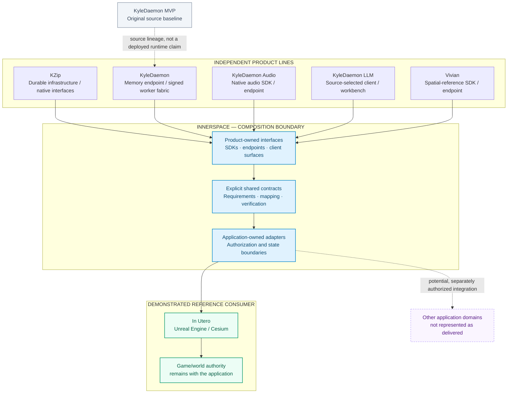

# INNERSPACE — Visual Technology Overview

**Public-disclosure candidate · Proprietary architecture summary · No software distribution**

Innerspace brings distinct software product lines together using explicit interfaces, SDKs, adapter contracts, and owner-controlled execution boundaries. The products retain their own identity, responsibilities, state, and development histories. **In Utero is one demonstrated application of the stack—not the reason the infrastructure products exist.**

## Architecture at a glance

**Diagram interpretation:** The arrows show an architectural *integration pattern*, not mandatory runtime dependencies between every product. Consumers use the capabilities they require. No arrow represents a transfer of software ownership, authorization, or authoritative application state.

## Independent product responsibilities

| Repository / product line | Documented responsibility | Delivery distinction |
| --- | --- | --- |
| **KZip** | Durable infrastructure, archive/node operations, and native reference interfaces. | Accepted standalone native package. |
| **KyleDaemon** | Accepted CPU memory endpoint and signed task/worker fabric. | Published source/interfaces; accepted complete runtime depends on the frozen master distribution. |
| **KyleDaemon Audio (KDA)** | Native audio endpoint, SDK, and bridge adapters. | Accepted standalone native package. |
| **KyleDaemon LLM** | Source-selected memory client/workbench, verified endpoint mapping, and selected export. | Published source/interfaces; offline runtime dependencies remain distinct. |
| **Vivian** | Spatial/reference-context SDK and endpoint with frame/unit-aware mapping. | Published source/interfaces; context is non-authoritative to the consuming application. |
| **KyleDaemon MVP** | Original source baseline and reference foundation. | Preserved source baseline; **not** an independently accepted new runtime endpoint. |
| **In Utero** | UE/Cesium reference application using independent product adapters. | Demonstrated integration; not a distribution of the suite or an authorization for physical-world operation. |

## Integration rules that matter

1. **Independent product authority.** Each product retains control of its interfaces, dependencies, state, and distribution.
2. **Explicit contract boundaries.** A requested capability, compatible provider, caller adapter, execution authority, and accepted result are not interchangeable.
3. **Application-owned state.** A consumer decides what it can authorize and commit. In Utero's authoritative simulated world remains with its UE/Cesium application.
4. **No forced suite dependency.** The full-stack demonstration shows composition; it does not mean every product requires the game or that every consumer must use every product.
5. **Verification by accepted scope.** Build220/221 document selected integration and package acceptance, not unrestricted production readiness, industrial certification, or independently audited security.

## Evidence and access

The supporting Build220/Build221 acceptance receipts remain privately retained. A summary of accepted checkpoints and receipt integrity references is in [Engineering Evidence](ENGINEERING_EVIDENCE.md).

This document is **an architectural overview, not a deployable specification, API reference, implementation guide, or software license**. Source code, SDK implementations, native binaries, proprietary internals, model weights, credentials, and full evidence packages are not offered here.

Commercial evaluation and distribution require separate authorization; see [Licensing and Access](LICENSING_AND_ACCESS.md). An approved business inquiry contact will be published separately.

[Back to the Innerspace Portfolio](README.md).
