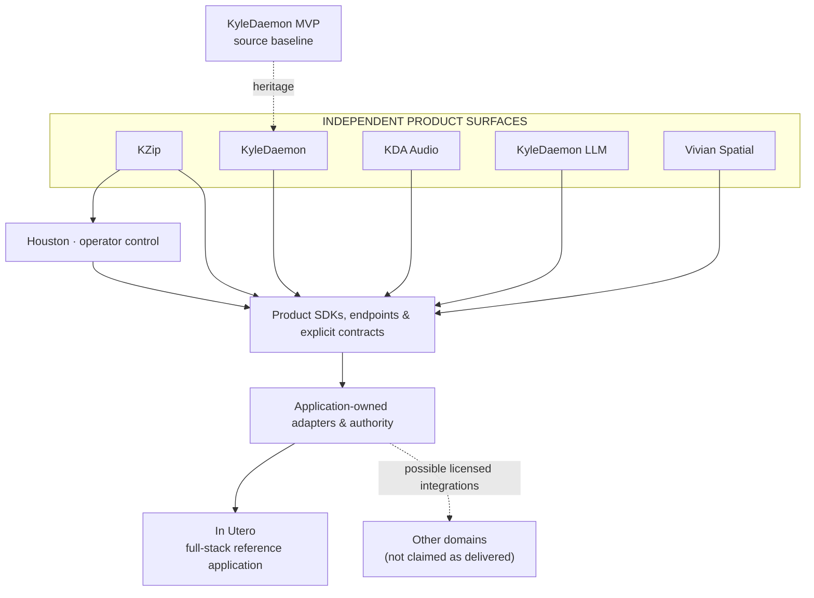

# INNERSPACE
## Proprietary Modular Software Infrastructure

**Independent software products. Explicit SDK and adapter boundaries. One integrated infrastructure suite.**

Innerspace is an integrated infrastructure suite assembled from independently developed software products.

Its architecture uses product-owned capabilities, SDKs, adapters, endpoints and explicit integration contracts. Products retain their separate identities, responsibilities and authority boundaries.

**This repository is a presentation portfolio only. It does not distribute software or grant an open-source or commercial license.**

### Portfolio navigation

- [Executive Overview — Corporate Technology Brief](EXECUTIVE_OVERVIEW.md)
- [Engineering Evidence — Accepted Checkpoints and Integrity References](ENGINEERING_EVIDENCE.md)
- [Licensing, Rights, and Controlled Access](LICENSING_AND_ACCESS.md)
- [Potential Real-World Robotics Applications — Concept, Not Deployment](ROBOTICS_APPLICATION_CONCEPT.md)

## Technology Portfolio

| Product | Engineering Domain |
| --- | --- |
| **KZip** | Durable infrastructure, archive/node operations and native interfaces |
| **KyleDaemon** | Memory infrastructure and signed task/worker coordination |
| **KyleDaemon Audio (KDA)** | Native audio endpoint, SDK and integration adapters |
| **KyleDaemon LLM** | Memory client/workbench, source selection and endpoint integration |
| **Vivian** | Spatial reference infrastructure, mapping and coordinate-aware SDK |
| **KyleDaemon MVP** | Original source baseline and reference foundation |
| **Houston** | Signed operator control, durable requests, reconnect and worker lifecycle over KZip |
| **In Utero** | Full-stack reference application demonstrating interoperability |

## Business and integration proposition

Innerspace provides a set of **independently managed infrastructure products** that can be evaluated and integrated through defined SDKs, endpoints and application-owned adapters. The combined reference implementation demonstrates that these boundaries can coexist within a demanding simulation environment, without claiming that the same integration is already certified for unrelated industries.

**For business and technical reviewers:** start with the [Executive Overview](EXECUTIVE_OVERVIEW.md) for capabilities, evidence boundaries and potential evaluation pathways. The portfolio is private, documentation-only and does not grant software access by itself.

## Visual technology architecture

This is an **integration overview**, not a runtime dependency diagram. Each product remains independently owned, and In Utero is an application consuming the stack—not the stack itself. [Explore the visual architecture and product boundaries](ARCHITECTURE_OVERVIEW.md).

## How the products fit together

Independent providers expose capabilities through their own endpoints and SDK contracts. Adapters connect these capabilities to a consumer application without transferring product ownership or application authority.

**In Utero** is a UE/Cesium-based reference implementation demonstrating interoperability. It is not the reason the independent infrastructure products exist, and its game-domain acceptance does not authorize physical-world operations.

[Houston](https://github.com/Cuebster/Houston) adds signed operator control, durable requests and recovery over KZip. In Utero uses its reference adapter for worker recall and archive. Unreal and Cesium retain world authority.

## Candidate real-world applications

A supervised **robotics-assisted moving and materials-handling service** is one potential application for independently licensed Innerspace components. This is a future integration concept, **not an accepted physical robot deployment or workplace safety claim**. Real hardware requires separate sensing, control, protective systems, risk assessment and field validation. See the [robotics application concept](ROBOTICS_APPLICATION_CONCEPT.md).

## Engineering demonstration

Build220 and Build221 established documented integration, packaging, and reconciliation checkpoints. KZip and KyleDaemon Audio have accepted standalone native packages; other published product repositories may represent source/interfaces that still depend on the accepted master distribution for complete offline runtime reconstruction.

See the [engineering evidence overview](ENGINEERING_EVIDENCE.md) for the accepted scope and integrity references. The underlying verification receipts are retained privately and have not been presented here for independent public inspection.

## Development media and soundtrack

- **Existing engineering videos and screenshots:** [Owner-maintained Innerspace / In Utero development media on Facebook](https://www.facebook.com/KyleDanielWebster). Footage and images stay at the original source; access to individual posts depends on Facebook visibility settings.
- **IN UTERO — Martian Lemonade (15 game tracks, 42 minutes):** [Listen on YouTube Music](https://music.youtube.com/playlist?list=PLH9RptlOAhk4). Creator-curated game soundtrack playlist. This music archive does not imply that the tracks are integrated into the live game Director.
- **Martian Lemonade — full-album files:** [Owner-hosted Google Drive stream and download folder](https://drive.google.com/drive/folders/1LpsiEei76iLl5-PxSwKIiqCnoRcK7y8M?usp=sharing). The owner describes these as high-bitrate downloadable tracks; file access depends on Drive sharing permissions.

These external links are for presentation and context, not independent certification or software distribution.

## Commercial positioning and availability

Innerspace is presented as proprietary technology intended for **controlled commercial licensing and authorized technical evaluation**. Publication of a product description, screenshot, or engineering summary is not permission to use, reproduce, deploy, or redistribute the underlying software.

An approved business inquiry channel and evaluation terms will be provided separately; **no public access to implementations or trial endpoints is offered through this repository**.

Individual capability descriptions and acceptance records are not claims of universal production readiness, industrial certification, or security certification. Rights and access are described in [Licensing and Access](LICENSING_AND_ACCESS.md).
